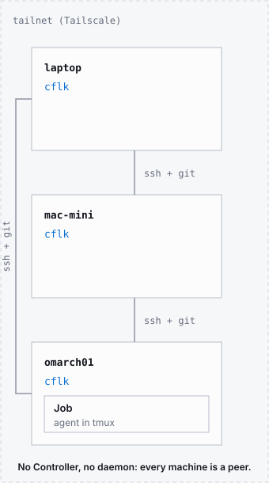
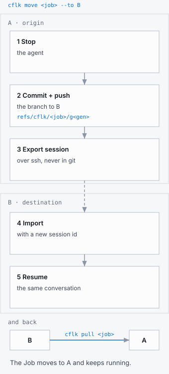

Code Flock home: [autarquico.github.io/codeflock](https://autarquico.github.io/codeflock/).

Code Flock has no server. Each machine runs `cflk`, and the network is what Tailscale, ssh, tmux and git already give you.

## Peer

A machine of your tailnet with `cflk`, `git`, `tmux` and at least one harness (`claude`, `codex`). Its identity is its stable Tailscale node ID; the hostname is only for display. Every peer is equal: any of them can launch a Job, hand it to another, receive one, and list the Jobs of all.

Peers trust each other fully. They are all machines of the same person, and what a peer can do on another is what you could do by ssh. The `read` profile of the MCP server limits only the local model, not the peers.

## Job

An agent working on a branch of a repo, on one peer. It has:

- an `id`, `job-` plus ten random characters;
- the `repo` (its origin, so ssh and https give the same one) and the branch `cflk/<id>`;
- the `harness` and the agent's `session_id`;
- a generation, `gen`, that goes up each time the Job moves;
- the `peer` that owns it, and a `state`.

The Job lives in `~/.local/state/cflk/jobs/<id>/` on its peer, with a worktree per generation. That directory is the only truth about the Job on that peer.

## States

| State | Meaning |
| --- | --- |
| `running` | The agent is working |
| `waiting` | It stopped to ask a person |
| `stopping` | Being stopped; a process may remain, run `cflk stop` |
| `stopped` | Stopped, resumable here |
| `done`, `failed` | The agent finished, or exited with an error |
| `lost` | No process and no exit record, for example after a reboot; `cflk resume` brings it back |
| `moving` | A move is in progress or unconfirmed |
| `finishing` | A `pull --finish` is in progress |
| `moved` | It lives on another peer |

Any command that reads a Job works out its state at that moment, from tmux and from the exit record. Nothing restarts by itself.

## How a Job moves

The rule is one: the origin keeps the Job until the destination confirms it has started it, and in any doubt the Job stays `moving` until you resolve it.

1. The origin stops the agent, and waits until its whole process group is gone.
2. It commits the work and exports the session.
3. It reserves the move (`moving`), and pushes the code to a fixed ref in a bare mirror on the destination.
4. The destination prepares a worktree at that exact commit and keeps the session aside. Nothing starts.
5. The origin asks it to activate. The destination imports the session with a new session id and starts the agent. From that moment the Job is the destination's.
6. The origin marks it `moved`.

The code travels with git and the conversation with an export of the session. The conversation never goes into git, so neither your origin nor any branch you push has it.

## Out of scope

No scheduler (you choose the peer, or `--on any`), no central secrets (each peer has its own logins), no Projects, Workflows or Environments, no submodules with changes, no Windows.
